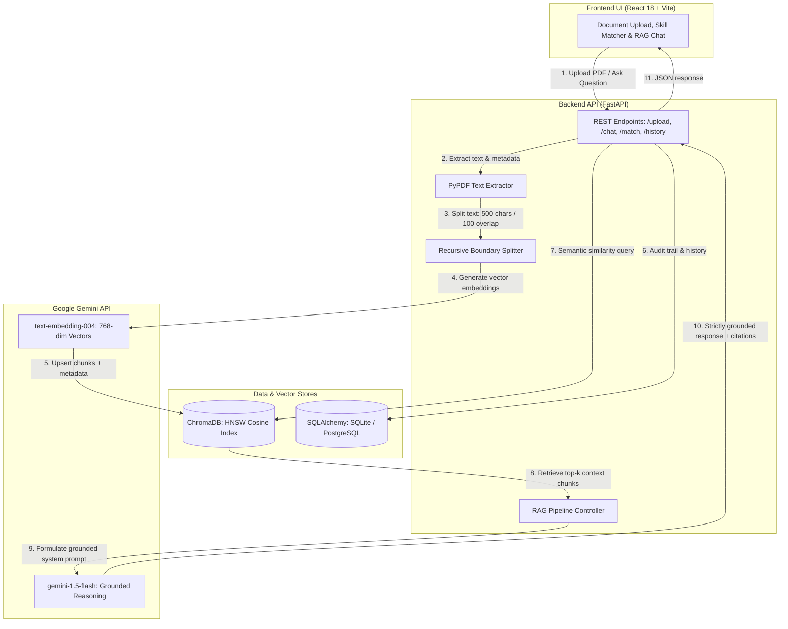

# ResumeRAG – AI Resume & Job Match Assistant 📄✨

[](https://www.python.org/)
[](https://fastapi.tiangolo.com/)
[](https://react.dev/)
[](https://www.trychroma.com/)
[](https://aistudio.google.com/)
[](https://www.sqlalchemy.org/)
[](https://www.docker.com/)
[](https://docs.pytest.org/)

A portfolio-ready AI application that uses **Retrieval-Augmented Generation (RAG)** to analyze resumes, compare them against job descriptions, identify skill gaps, provide tailored improvement suggestions, and answer conversational questions grounded in document context with verifiable page citations.

---

## 🏗️ System Architecture



---

## 🛠️ Technology Stack

| Layer | Component | Description |
|---|---|---|
| **API Framework** | FastAPI | High-performance async Python framework with automatic OpenAPI docs. |
| **Web Server** | Uvicorn | Production-ready ASGI web server. |
| **Document Processing** | PyPDF | Pure-Python PDF extraction supporting stream and in-memory bytes. |
| **Vector Database** | ChromaDB | Persistent vector store using HNSW cosine distance indexing. |
| **Embeddings & LLM** | Google Gemini API | `text-embedding-004` (768-dim embeddings) & `gemini-1.5-flash` (reasoning/chat). |
| **Relational Database** | SQLAlchemy 2.0 | Dual-mode ORM with SQLite for local dev & PostgreSQL for production. |
| **Frontend UI** | React 18 + Vite | Single Page Application with drag-and-drop upload, skill score dial, and chat. |
| **Containerization** | Docker & Compose | Production multi-stage Docker build packaging frontend and backend. |
| **Testing** | Pytest | 69 automated unit, integration, and security tests. |

---

## 📁 Project Directory Structure

```text
ResumeRAG/
├── backend/
│   ├── app/
│   │   ├── core/                  # Configuration, database engine & session dependency
│   │   │   ├── config.py          # Pydantic BaseSettings class
│   │   │   └── database.py        # SQLAlchemy engine, SessionLocal, get_db
│   │   ├── models/                # Pydantic & SQLAlchemy ORM schemas
│   │   │   ├── chunk.py           # TextChunk, SearchResult
│   │   │   ├── db_models.py       # DocumentRecord, ComparisonRecord, ChatMessageRecord
│   │   │   ├── document.py        # ExtractedPage, ExtractedDocument
│   │   │   ├── llm.py             # SkillMatchReport, SkillGapItem, AnswerWithCitations
│   │   │   ├── rag.py             # IngestionResponse, QueryResponse
│   │   │   └── requests.py        # ChatRequest, MatchRequest
│   │   ├── services/              # Business logic & external integrations
│   │   │   ├── chunking_service.py    # Recursive character text splitting
│   │   │   ├── embedding_service.py   # Gemini text-embedding-004 & cosine similarity
│   │   │   ├── history_service.py     # Relational CRUD data access layer
│   │   │   ├── llm_service.py         # Grounded prompt engineering & JSON schema mode
│   │   │   ├── pdf_service.py         # PyPDF parser & text normalizer
│   │   │   ├── rag_service.py         # Facade pipeline orchestrator
│   │   │   └── vector_store_service.py# ChromaDB HNSW collection manager
│   │   ├── api/                   # REST route endpoints (/upload, /chat, /match, /history)
│   │   │   └── routes.py          # Input sanitization, file size limits & error handling
│   │   └── main.py                # FastAPI entrypoint & frontend static mount
│   ├── tests/                     # Automated test suite (69 tests)
│   │   ├── test_api.py
│   │   ├── test_chunking_service.py
│   │   ├── test_database.py
│   │   ├── test_embedding_service.py
│   │   ├── test_environment.py
│   │   ├── test_llm_service.py
│   │   ├── test_pdf_service.py
│   │   ├── test_rag_service.py
│   │   ├── test_security_and_resilience.py
│   │   └── test_vector_store_service.py
│   └── requirements.txt           # Python dependencies
├── frontend/                      # React 18 + Vite Single Page Application
│   ├── src/
│   │   ├── components/            # Navbar, DocumentManager, MatchDashboard, ChatWindow, HistoryView
│   │   ├── services/              # Centralized API fetch client
│   │   ├── App.jsx                # Layout & state controller
│   │   ├── index.css              # Dark theme design system
│   │   └── main.jsx               # React DOM root entrypoint
│   ├── index.html                 # Single page HTML shell
│   ├── package.json               # Node dependencies & build scripts
│   └── vite.config.js             # Vite config & API reverse proxy
├── data/
│   └── sample_documents/          # Resumes and job postings for testing
├── Dockerfile                     # Multi-stage production container build
├── docker-compose.yml             # Orchestration with persistent volumes
├── .dockerignore                  # Docker build context exclusions
├── .env.example                   # Environment variable template
├── .env                           # Local secrets (ignored by Git)
├── .gitignore                     # Git ignore rules
└── README.md                      # Documentation & progress tracking
```

---

## 🚀 Setup & Installation

### 1. Prerequisites
- **Python 3.10+**
- **Node.js 20+** (for frontend development)
- A **Google Gemini API Key** (from [Google AI Studio](https://aistudio.google.com/))

### 2. Clone the Repository
```powershell
git clone <repository_url>
cd ResumeRAG
```

### 3. Setup Virtual Environment & Install Dependencies
```powershell
# Windows
python -m venv .venv
.\.venv\Scripts\Activate.ps1
pip install -r backend/requirements.txt

# Linux / macOS
python3 -m venv .venv
source .venv/bin/activate
pip install -r backend/requirements.txt
```

### 4. Configure Environment Variables
Copy `.env.example` to `.env` and insert your Gemini API key:
```powershell
cp .env.example .env
```
Edit `.env`:
```ini
GEMINI_API_KEY=your_actual_gemini_api_key_here
```

### 5. Run Verification Tests
Run the 69-test automated test suite:
```powershell
pytest backend/tests
```

---

## 💻 Running the Application

### Option A: Unified FastAPI Server (Serves Backend & React Dashboard)
FastAPI automatically serves the compiled React dashboard directly from port 8000:
```powershell
.\.venv\Scripts\python.exe -m uvicorn backend.app.main:app --reload --port 8000
```
- **Web App Dashboard**: [http://127.0.0.1:8000/app](http://127.0.0.1:8000/app)
- **Interactive Swagger Docs**: [http://127.0.0.1:8000/docs](http://127.0.0.1:8000/docs)

### Option B: Development Mode with Vite Hot Reloading
1. Start the FastAPI backend:
   ```powershell
   .\.venv\Scripts\python.exe -m uvicorn backend.app.main:app --reload --port 8000
   ```
2. In a second terminal, start the Vite development server:
   ```powershell
   cd frontend
   npm run dev
   ```
- Open [http://localhost:5173](http://localhost:5173) (Vite proxies all `/api` calls directly to FastAPI).

---

## 🐳 Docker Deployment

Run the complete multi-stage containerized stack with a single command:
```powershell
docker compose up --build
```
- The application will be available at [http://localhost:8000/app](http://localhost:8000/app).
- Vectors in `chroma_data` and SQLite records in `sqlite_data` persist across container restarts.

To run with a dedicated **PostgreSQL** container instead of SQLite:
```powershell
docker compose --profile postgres up --build
```

---

## 🔌 REST API Reference

| Method | Endpoint | Description |
|---|---|---|
| `GET` | `/api/health` | Health check endpoint returning service operational status. |
| `POST` | `/api/documents/upload` | Uploads a PDF (Resume or JD), chunks text, and indexes in ChromaDB. |
| `GET` | `/api/documents` | Lists all ingested documents with page counts and file sizes. |
| `DELETE` | `/api/documents/{filename}` | Purges a document and all associated vector embeddings. |
| `POST` | `/api/chat` | Conversational RAG Q&A with source citations and grounding check. |
| `POST` | `/api/match` | Compares a resume against a job description; returns match %, skill gaps, and advice. |
| `GET` | `/api/history/matches` | Retrieves past skill comparison reports from the database. |
| `GET` | `/api/history/chat` | Retrieves conversational history with questions and citations. |

---

## 🧠 Key RAG & Generative AI Technical Concepts (Interview Cheat Sheet)

When presenting this project in software developer and Generative AI interviews, highlight these engineering principles:

1. **Why RAG instead of Fine-Tuning?**
   - Fine-tuning changes model weights to learn a style or domain; it is expensive, slow to update, and prone to hallucinations.
   - RAG provides dynamic, real-time factual context directly in the prompt. When a new resume is uploaded, it is available for querying in seconds with 100% verifiable source citations.

2. **Recursive Character Chunking with Overlap (500 chars, 100 overlap)**:
   - Splitting strictly by character count cuts words and sentences in half.
   - We split hierarchically: double newlines (`\n\n`) ➡️ single newlines (`\n`) ➡️ periods (`. `) ➡️ spaces (` `).
   - The 100-character overlap ensures semantic context isn't lost across chunk boundaries.

3. **Cosine Similarity vs. Euclidean Distance**:
   - Cosine similarity measures the angle between vectors rather than their magnitude. A 5-word sentence and a 50-word paragraph discussing the same concept will have close cosine similarity even if their Euclidean distance is large.

4. **Hallucination Defense in Grounded Prompts**:
   - We instruct Gemini with negative constraints: *"If the provided context does not contain sufficient facts to answer, explicitly respond that the information is not present. Do not speculate."*
   - We set temperature to `0.1` for factual deterministic retrieval.

5. **Defense-in-Depth Security**:
   - Path traversal sanitization prevents directory escape attacks.
   - 10 MB payload limits defend against memory exhaustion denial-of-service.
   - Secrets are isolated in `.env` and guarded by `.gitignore` and `.dockerignore`.

---

## 🗺️ Development Roadmap & Progress

- [x] **Phase 1: Project Planning, Architecture, Folder Structure, Virtual Environment, & Dependencies**
- [x] **Phase 2: PDF Document Loading & Text Extraction using PyPDF**
- [x] **Phase 3: Text Chunking Strategy (Size, Overlap, & Semantics)**
- [x] **Phase 4: Embeddings & Semantic Similarity Fundamentals**
- [x] **Phase 5: ChromaDB Setup, Vector Storage, & Retrieval**
- [x] **Phase 6: Gemini API Integration & Prompt Engineering**
- [x] **Phase 7: Complete RAG Pipeline with Source References**
- [x] **Phase 8: FastAPI Endpoints for Upload, Chat, & Job Matching**
- [x] **Phase 9: PostgreSQL & SQLAlchemy Integration**
- [x] **Phase 10: React Frontend Dashboard**
- [x] **Phase 11: Testing, Error Handling, Security, & Deployment**

---

## 📄 License
MIT License. Built for educational portfolio demonstration.
